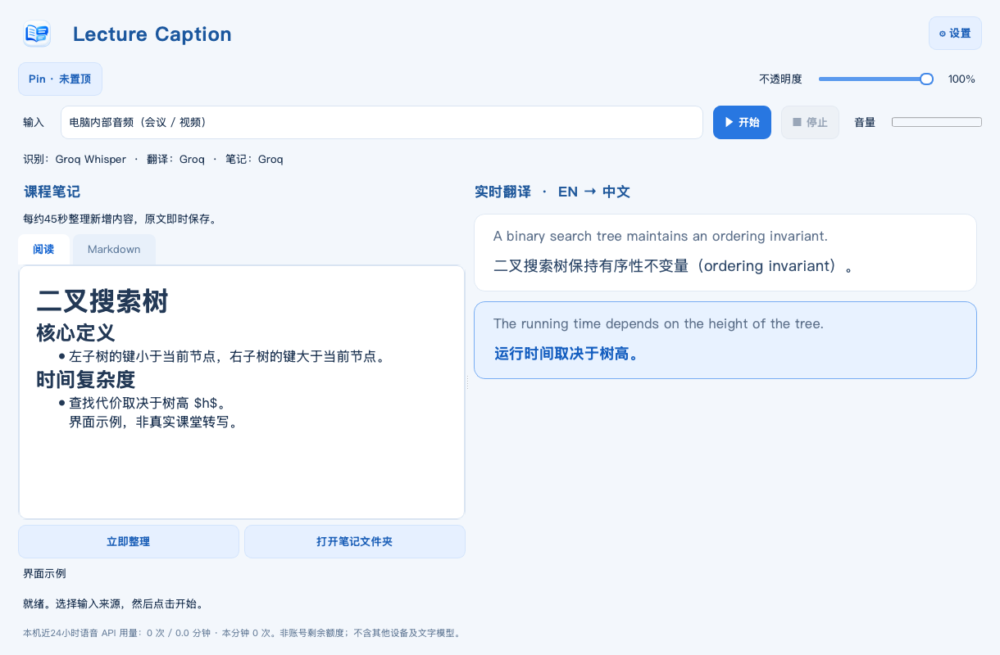

<p align="center"></p>
<h1 align="center">Lecture Caption</h1>
<p align="center">Follow the lecture. Keep the logic.<br>macOS 双语课堂字幕与实时 Markdown 笔记</p>

English · [简体中文](README.zh-CN.md) · [User guide](docs/USER_GUIDE.md) · [Privacy](docs/PRIVACY.md)

A lightweight macOS app for English CS and mathematics lectures: capture your microphone or computer audio, see English + Chinese caption history beside structured Markdown notes in one workspace. Choose cloud APIs or Apple’s on-device English speech and translation services. Structured notes use your configured text API.

> Stable release **2.4.2** · [Download for Apple Silicon Mac](https://github.com/superboycyc-dot/lecture-caption/releases/latest). macOS 14+. No Python or terminal setup required. The app is ad-hoc signed, not Apple notarized.



[](https://github.com/superboycyc-dot/lecture-caption/actions/workflows/ci.yml) [](https://github.com/superboycyc-dot/lecture-caption/releases/latest) [](LICENSE)

Version 2.4.2 adds **numeric usage sharing**, enabled only after the explicit first-run agreement (withdrawable in Settings) through a verified public HTTPS receiver. No Tailscale setup is needed. See [privacy details](docs/PRIVACY.md) and [independent public acceptance](https://github.com/superboycyc-dot/lecture-caption/actions/runs/40411300895).

## Features

- **Classroom and online audio:** microphone input, or native ScreenCaptureKit system audio without a virtual audio driver. One source at a time.
- **One workspace:** notes left, caption history right; current segment highlighting, animated scroll, manual history browsing and return-to-latest. Settings open only when requested.
- **Main-window controls:** Start/Stop, input source, live audio meter, clearly labeled local speech-API accounting. Opacity lives in Settings.
- **Apple local captions:** optional on-device English recognition and English-to-Chinese translation (macOS 15+, installed language resources). With automatic notes off, no API key is needed. No silent cloud fallback.
- **Live study notes:** continuously revised Chinese Markdown, normally every 45 seconds, emphasizing definitions, assumptions, arguments, algorithms and complexity.
- **CS/math terminology:** supply course terms; uncertain formula details are explicitly requested to be marked for checking.
- **macOS Keychain:** save your API key once; reload it at startup. No key in ordinary config or command arguments.
- **Durable text:** local Markdown and transcript events; unfinished notes retain their source text. No raw audio is saved.
- **Bounded queues:** stale audio is dropped rather than allowing lag to grow indefinitely; gaps are marked.
- **Bring your server:** configurable OpenAI-compatible endpoints for a future home inference server.

## Install

> 🔴 **macOS may block the first launch. Follow the [illustrated opening guide](docs/INSTALL.zh-CN.md) before continuing.**

[](https://github.com/superboycyc-dot/lecture-caption/releases/download/v2.4.2/LectureCaption-2.4.2-macOS-arm64.zip)

Click the blue button to download directly. No GitHub account required.

1. Click the blue **Download for Mac** button above.
2. Extract it and drag **Lecture Caption.app** to **Applications**.
3. Open the app. If macOS blocks this unnotarized build, use the explicit Open Anyway flow in **System Settings → Privacy & Security**, after checking the release checksum and source. [See the illustrated four-step guide](docs/INSTALL.zh-CN.md) (Chinese screenshots).
4. Read and accept [软件使用规则](docs/SOFTWARE_RULES.zh-CN.md) in the first-run guide; the unchecked agreement explicitly includes numeric usage sharing. Then connect to Groq, register/sign in, create and copy your own API key, then return and click Next. The app validates it and saves it to Keychain. Apple backup resources are prepared in the same flow.
5. Select your microphone or system audio, then start capture. Grant the relevant macOS permission when prompted.

**Free application, quota-limited API.** Groq has a free tier; availability, model IDs and account quotas can change. This app cannot verify your billing plan and does not guarantee zero charges on a paid account. Check [your limits](https://console.groq.com/settings/limits) and [Groq documentation](https://console.groq.com/docs/rate-limits). No automatic fallback to a different paid provider is implemented.

## Apple local setup

Open Settings, choose Apple Speech and Apple Translate, and click **准备 Apple 英中翻译语言包**. Finish the native download dialog. Local speech requires English dictation resources and Speech Recognition permission; enable/download English dictation in macOS Keyboard settings if needed. Unsupported/missing resources produce an explicit error. Turn off automatic notes to use captions without Groq. Local recognition is experimental and uses general English dictation; the course glossary currently applies to cloud recognition only. Local services still use system ML models and consume power.

## What to expect

Captions are **chunked near-real-time**, not word-by-word simultaneous interpretation. Cloud previews normally update every 8 seconds and Apple previews every 3 seconds, plus processing latency. Both revise the current utterance until a pause, with a 24-second bound for continuous speech. Translation calls and speech calls are processed in order. Notes are updated separately.

The app hears audio only: it cannot infer unwritten/unspoken board content. ASR and notes can be wrong, especially for notation, subscripts, proofs and code. The built-in Markdown view preserves LaTeX source but does not typeset math; open the `.md` in a math-aware editor if needed.

**Pause behavior:** capture stops immediately; incomplete chunks and queued audio are discarded and marked. Wait for the final sentence to appear before pausing if you need to preserve it. Notes for already transcribed text may finish in the background.

## Data and privacy

Local files live in:

```text
~/Library/Application Support/Lecture Caption/
├── config.json                   # optional; never put keys here
├── logs/
└── sessions/<date-time>/
    ├── notes.md
    ├── transcript.md              # cumulative, revised source document
    └── transcript.jsonl           # original and translation update events
```

In cloud mode, audio chunks go to the selected speech API and transcripts go to the selected translation/notes API. Apple speech/translation stay on-device; enabling structured notes still sends recognized text to your notes API. Keychain stores credentials on this Mac, without enabling iCloud synchronization. There is no app-owned backend, analytics or automatic audio upload before you start capture. See [Privacy](docs/PRIVACY.md).

## Develop and build

Requires an Apple Silicon Mac, Python 3.13, Xcode Command Line Tools, and network access for Python dependencies. The SDK must include Translation.framework (Xcode 16+).

```bash
python3.13 -m venv .venv
source .venv/bin/activate
python -m pip install -r requirements-dev.txt
python scripts/build_native.py
python caption.py
```

Build the independent app and verify its signature:

```bash
python scripts/build_app.py
```

The result is `dist/Lecture Caption.app`, containing Python, Qt and runtime dependencies. No model weights or API keys are bundled. Apple language resources are managed by macOS. Runtime dependencies are pinned in `requirements-lock.txt`. The native helpers target macOS 14.0 / arm64. Source builds are reproducible as a documented process; binary byte-for-byte identity is not claimed.

Checks:

```bash
ruff check .
ruff format --check caption.py core.py credentials.py scripts tests
python -m unittest discover -s tests -v
python scripts/check_release.py
```

CI builds and tests on a standard Apple Silicon macOS runner. Tag releases use the same build script and publish ZIPs and SHA-256 sums. See [Release process](docs/RELEASING.md), [Contributing](CONTRIBUTING.md) and [Roadmap](docs/ROADMAP.md).

## License and credits

Application code and the project icon are provided under **MIT**. The icon was generated with AI and selected for this project; no exclusivity claim is made.

The VAD, chunking, WAV serialization and quota modules derive from [AwesomeMi/realtime-transcribe](https://github.com/AwesomeMi/realtime-transcribe), MIT, copyright 2026 AwesomeMi. Its license and exact commit are retained in `vendor/`.

Qt/PySide, Python and other bundled libraries retain their own licenses. Qt is dynamically bundled; see [THIRD_PARTY_NOTICES.md](THIRD_PARTY_NOTICES.md), `licenses/` and the rebuild instructions. This project is independent of Apple, Groq and upstream projects.

When Groq returns rate-limit headers, the main window also displays the latest server request/token snapshot with its model and timestamp. This is not a billing balance or a live combined quota for all models. See [Groq rate-limit headers](https://console.groq.com/docs/rate-limits).

The compact toolbar includes input, recognition/translation backends, English/Chinese/bilingual presentation, Start/Pause, Stop and a settings icon. Audio level and usage live at the bottom. Note hints disappear on first content; refresh/folder icons remain inside the pane. Right-click notes to switch Markdown source/read view. Caption language selection changes presentation only, retaining translations in the transcript.

On macOS 26+, local recognition uses SpeechAnalyzer/SpeechTranscriber with explicit AssetInventory preparation. Use **准备 Apple 英文语音资源** in app Settings if assets are missing; toggling system Dictation is not sufficient for this engine. Older macOS uses the legacy on-device Speech API. Synthetic CS audio was verified through the native segment/recognition/Apple-translation pipeline without a cloud request; real classroom microphone accuracy still needs user verification.

Coherent captions now use borderless timestamped paragraphs: black source and blue translation on a light surface, with current-paragraph emphasis. Both Apple and Groq periodically re-recognize cumulative utterance audio and retranslate the complete current text, revising the same paragraph until a natural pause (bounded at 24 seconds for continuous speech). Previous translations remain visible while an update is pending. Notes consume completed paragraphs once; pausing preserves the last recognized draft. Repeated cumulative audio consumes more Groq speech quota than independent slices. Time ranges are approximate capture spans, not word alignment.

Live selectors remain enabled during capture. Translation-only switches keep capture and ASR running and retranslate the current paragraph; source/ASR switches save the latest recognized draft, reconnect input and discard stale-generation results. Unrecognized tail audio may be lost during input reconnection and is marked. The level indicator is green while capturing, grey when idle and a red exclamation on device errors. Daily API allowance sits beside locally counted 24h speech requests, without duration/processing-time clutter. Return-to-latest is a 32px viewport overlay: appears when browsing older text and disappears at the bottom without resizing content.

Notes now revise one coherent document, backed by a cumulative transcript.md. Long lectures send the full previous note document, about 18000 characters of recent whole transcript paragraphs, and all unprocessed text; the complete original stays on disk. Enabling notes sends this accumulated context, including earlier locally recorded content in the current lecture, to the configured notes API.
