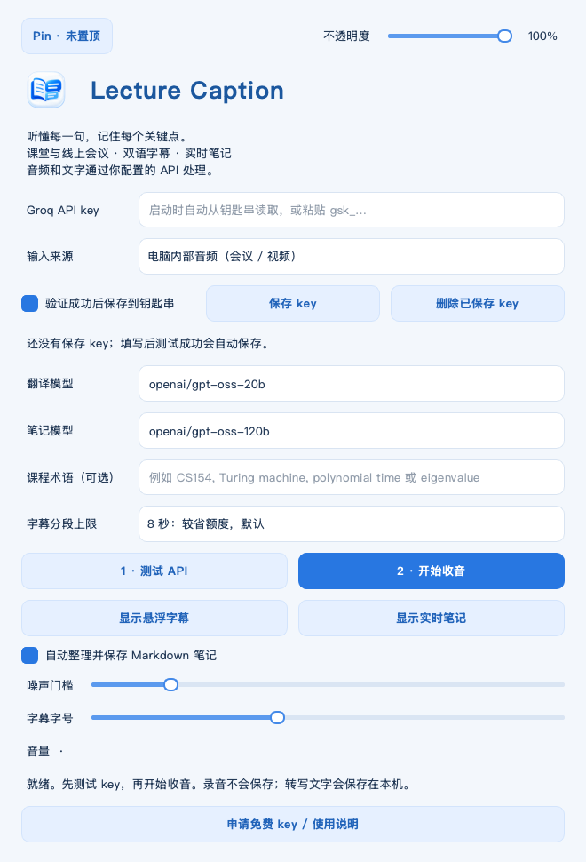

<p align="center"></p>
<h1 align="center">Lecture Caption</h1>
<p align="center">Follow the lecture. Keep the logic.<br>macOS 双语课堂字幕与实时 Markdown 笔记</p>

English · [简体中文](README.zh-CN.md) · [User guide](docs/USER_GUIDE.md) · [Privacy](docs/PRIVACY.md)

A lightweight macOS app for English CS and mathematics lectures: capture your microphone or computer audio, see English + Chinese floating captions, and collect structured Markdown notes while you listen. Your Mac handles capture and display; your configured API handles inference. No local AI models are loaded.

> Early release, v0.3.0. Apple Silicon, macOS 14+. The original pipeline was exercised on an M5 Mac; full-length lectures, different microphones and conferencing apps still need broader testing. The app is ad-hoc signed, not Apple notarized.



[](https://github.com/superboycyc-dot/lecture-caption/actions/workflows/ci.yml) [](https://github.com/superboycyc-dot/lecture-caption/releases/latest) [](LICENSE)

## Features

- **Classroom and online audio:** microphone input, or native ScreenCaptureKit system audio without a virtual audio driver. One source at a time.
- **Bilingual floating captions:** English above Chinese, with independent Pin and 30–100% opacity controls.
- **Live study notes:** incremental Chinese Markdown, normally every 45 seconds, emphasizing definitions, assumptions, arguments, algorithms and complexity.
- **CS/math terminology:** supply course terms; uncertain formula details are explicitly requested to be marked for checking.
- **macOS Keychain:** save your API key once; reload it at startup. No key in ordinary config or command arguments.
- **Durable text:** local Markdown and transcript events; unfinished notes retain their source text. No raw audio is saved.
- **Bounded queues:** stale audio is dropped rather than allowing lag to grow indefinitely; gaps are marked.
- **Bring your server:** configurable OpenAI-compatible endpoints for a future home inference server.

## Install

1. Download the **macOS arm64 ZIP** from this repository's **Releases** page.
2. Extract it and drag **Lecture Caption.app** to **Applications**.
3. Open the app. If macOS blocks this unnotarized build, use the explicit Open Anyway flow in **System Settings → Privacy & Security**, after checking the release checksum and source.
4. Get your own [Groq API key](https://console.groq.com/keys), paste it into the app, and select **测试 API**. Successful validation saves it to Keychain by default.
5. Select your microphone or system audio, then start capture. Grant the relevant macOS permission when prompted.

**Free application, quota-limited API.** Groq has a free tier; availability, model IDs and account quotas can change. This app cannot verify your billing plan and does not guarantee zero charges on a paid account. Check [your limits](https://console.groq.com/settings/limits) and [Groq documentation](https://console.groq.com/docs/rate-limits). No automatic fallback to a different paid provider is implemented.

## What to expect

Captions are **chunked near-real-time**, not word-by-word simultaneous interpretation. Default maximum chunk length is 8 seconds, plus network and inference latency. Translation calls and speech calls are processed in order. Notes are updated separately.

The app hears audio only: it cannot infer unwritten/unspoken board content. ASR and notes can be wrong, especially for notation, subscripts, proofs and code. The built-in Markdown view preserves LaTeX source but does not typeset math; open the `.md` in a math-aware editor if needed.

**Pause behavior:** capture stops immediately; incomplete chunks and queued audio are discarded and marked. Wait for the final sentence to appear before pausing if you need to preserve it. Notes for already transcribed text may finish in the background.

## Data and privacy

Local files live in:

```text
~/Library/Application Support/Lecture Caption/
├── config.json                   # optional; never put keys here
├── logs/
└── sessions/<date-time>/
    ├── notes.md
    └── transcript.jsonl           # original and translation update events
```

Audio chunks go to the selected speech API; transcripts go to the selected translation/notes API. Keychain stores credentials on this Mac, without enabling iCloud synchronization. There is no app-owned backend, analytics or automatic audio upload before you start capture. See [Privacy](docs/PRIVACY.md).

## Develop and build

Requires an Apple Silicon Mac, Python 3.13, Xcode Command Line Tools, and network access for Python dependencies.

```bash
python3.13 -m venv .venv
source .venv/bin/activate
python -m pip install -r requirements-dev.txt
python scripts/build_native.py
python caption.py
```

Build the independent app and verify its signature:

```bash
python scripts/build_app.py
```

The result is `dist/Lecture Caption.app`, containing Python, Qt and runtime dependencies. No AI model weights or API keys are bundled. Runtime dependencies are pinned in `requirements-lock.txt`. The native helpers target macOS 14.0 / arm64. Source builds are reproducible as a documented process; binary byte-for-byte identity is not claimed.

Checks:

```bash
ruff check .
ruff format --check caption.py core.py credentials.py scripts tests
python -m unittest discover -s tests -v
python scripts/check_release.py
```

CI builds and tests on a standard Apple Silicon macOS runner. Tag releases use the same build script and publish ZIPs and SHA-256 sums. See [Release process](docs/RELEASING.md), [Contributing](CONTRIBUTING.md) and [Roadmap](docs/ROADMAP.md).

## License and credits

Application code and the project icon are provided under **MIT**. The icon was generated with AI and selected for this project; no exclusivity claim is made.

The VAD, chunking, WAV serialization and quota modules derive from [AwesomeMi/realtime-transcribe](https://github.com/AwesomeMi/realtime-transcribe), MIT, copyright 2026 AwesomeMi. Its license and exact commit are retained in `vendor/`.

Qt/PySide, Python and other bundled libraries retain their own licenses. Qt is dynamically bundled; see [THIRD_PARTY_NOTICES.md](THIRD_PARTY_NOTICES.md), `licenses/` and the rebuild instructions. This project is independent of Apple, Groq and upstream projects.
