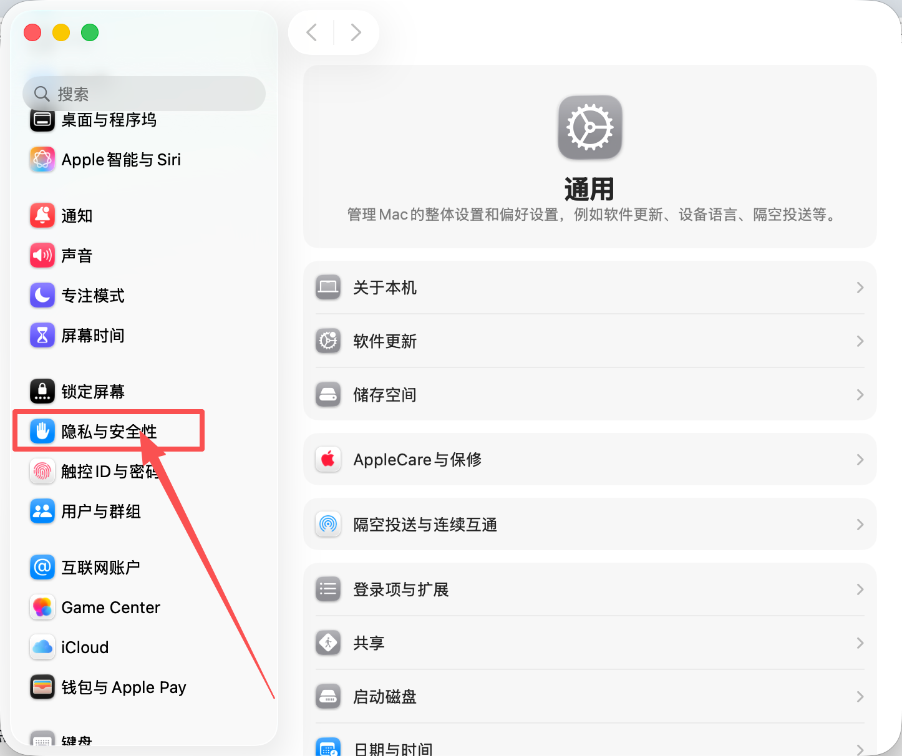
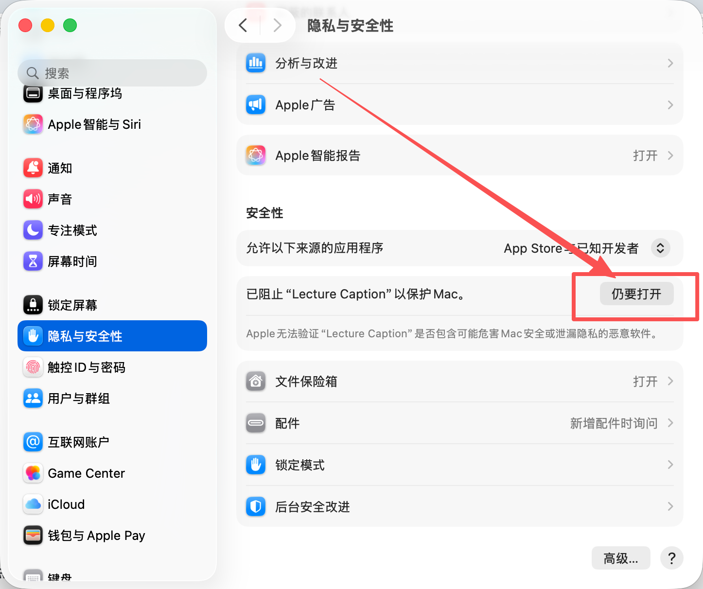
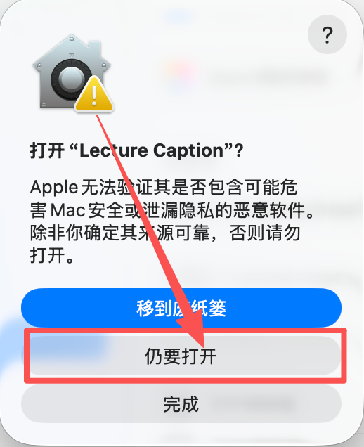

# Mac 安装与首次打开图解

先[下载 Mac 版](https://github.com/superboycyc-dot/lecture-caption/releases/latest)，解压后把 **Lecture Caption.app** 拖进“应用程序”，再双击打开。

## 首次打开被 macOS 拦截？按图操作

当前版本尚未 Apple 公证。确认从本项目的官方 GitHub 发布页下载后，按下面四步打开 **Lecture Caption**。

**① 打开“系统设置”**

点击屏幕左上角的  菜单，选择“系统设置”；图标长这样：

**② 点击左侧“隐私与安全性”**

在左边列表中找到红框标出的“隐私与安全性”。找不到时向下滚动左侧列表。

**③ 在右侧找到 Lecture Caption，点击“仍要打开”**

向下滚动右侧页面到“安全性”，在“已阻止 Lecture Caption”旁边点击红框按钮。若没有这个按钮，先到“应用程序”尝试打开一次 Lecture Caption，再回到此页面。

**④ 在弹出的确认窗口中，再点一次“仍要打开”**

点击下图红框中的“仍要打开”；如果系统要求验证身份，按提示使用触控 ID 或 Mac 登录密码。完成后应用会打开，跟随首次使用指南继续配置即可。

